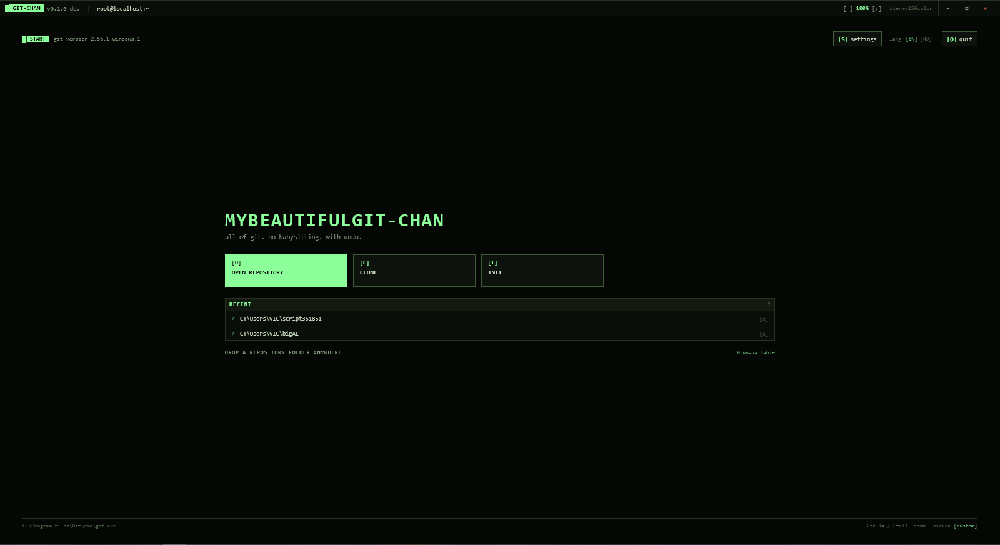
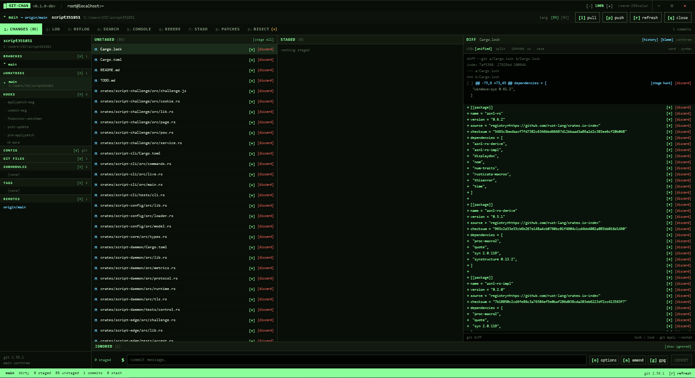
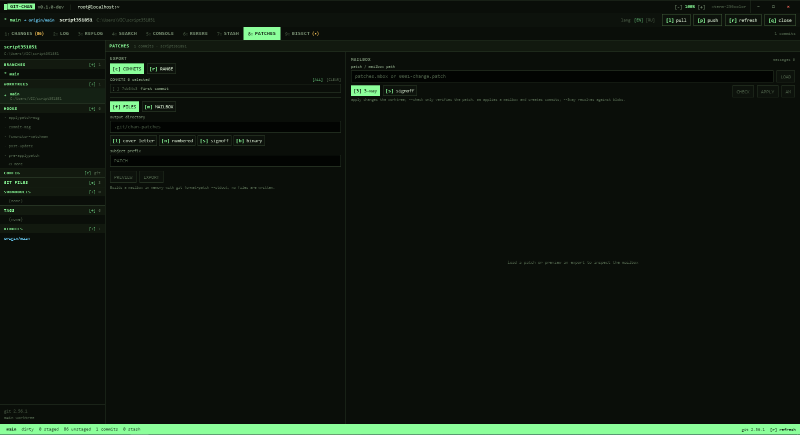
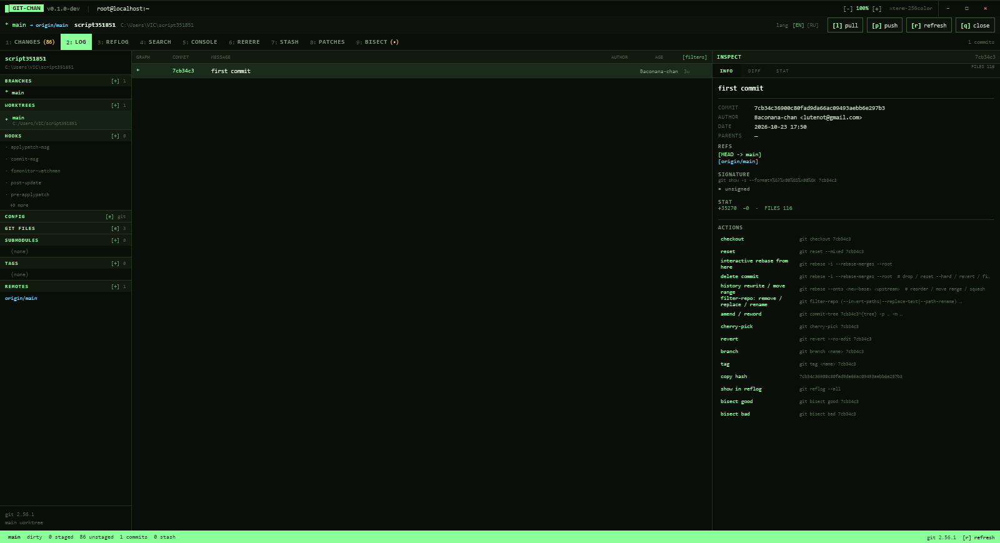

# MyBeautifulGit-chan

**A terminal-flavored Git client that shows its work.**

MyBeautifulGit-chan is a Kotlin Multiplatform / Compose Multiplatform desktop Git GUI. It is built
around a simple rule: if Git can do it, the app should let you do it too — with the exact command,
the consequences, and a way back.

The interface is a black CRT terminal with phosphor-green monospace text. Dangerous operations are
not hidden behind artificial restrictions. They are explained, previewed, and backed up.

> **Status:** early development (`v0.1.0-dev`). Desktop is the primary platform; Android is planned
> after the desktop 1.0 release. Expect UI and APIs to change.

<table align="center">
  <tr>
    <td></td>
    <td></td>
  </tr>
  <tr>
    <td></td>
    <td></td>
  </tr>
</table>

<p align="center"><em>Early visual mockup, not a screenshot of the final UI.</em></p>

## Contents

- [Why another Git client?](#why-another-git-client)
- [Features](#features)
- [Platform support](#platform-support)
- [Tech stack](#tech-stack)
- [Requirements](#requirements)
- [Getting started](#getting-started)
- [Build and test](#build-and-test)
- [Project layout](#project-layout)
- [Configuration and local data](#configuration-and-local-data)
- [Security](#security)
- [Roadmap](#roadmap)
- [Documentation](#documentation)
- [License](#license)

## Why another Git client?

Most Git GUIs are either simplified wrappers or an opaque collection of buttons. This project takes
the opposite approach:

- **All of Git.** History rewriting, force-pushes, filter-repo and remote branch/tag deletion are
  first-class operations, not hidden terminal-only knowledge. The command console is available for
  everything else.
- **No hidden semantics.** Every Git operation maps to a real Git command. The command is shown
  before and after the operation and can be copied into a terminal.
- **Warnings, not nannies.** A destructive operation is not blocked by policy. It is explained:
  what will happen, what will become unreachable, and how to recover it.
- **Undo where possible.** Rewrites create backup refs, reset keeps the previous tip, and recent
  operations offer an undo path through reflog.
- **Local-first.** No telemetry. Settings and credentials stay on the machine.

## Features

### Repository workspace

- Open an existing repository, clone a remote, or create a new repository with `git init -b`.
- Multiple repository tabs with independent controllers and live background operations; opening
  another repository adds a tab instead of replacing the current one, and closing a tab returns to
  its neighbour. Open repository tabs and the active tab are restored from a private
  `session.properties` on the next start; missing folders are skipped.
- Recent repositories on the welcome screen, in the folder picker and as command-palette actions,
  plus drag-and-drop folder opening into a new tab.
- System Git discovery through `PATH` and standard install locations, with a real `git --version`
  check and an install/update screen for Windows, macOS and Linux.
- Custom terminal-style folder picker with drives, recent folders, hidden folders and `.git`/bare
  repository detection. Can switch to the native system picker (Windows `IFileDialog`, macOS
  `NSOpenPanel`, Linux XDG portal) and remembers the choice.
- Status, staged/unstaged/conflicted/untracked/ignored files, branches, remotes, tags, worktrees,
  submodules and incomplete operations in one workspace.
- Auto-refresh on `.git` and working-tree changes with a short debounce, plus manual refresh.

### History and inspection

- Commit history with metadata and a parent-based graph: colored lanes, merge markers and collapsible
  side branches. The graph is built from commit parents, not parsed from ASCII art.
- Filters by branch/ref, author, path, date range, message and pickaxe (`-S`), including “only mine”
  and “only current branch” toggles.
- Lazy commit inspector with signature status (`%G?`, `%GS`, `%GK`), first-parent diff for merges,
  and per-file `--numstat`.
- File history (`git log --follow`), line-by-line blame with jump-to-commit, and `git grep` search.
- Reflog browser with restore/reset actions and branch creation from reflog entries.
- Bisect tab with good/bad/skip markers, an optional automated test command, timeout handling and
  the raw `BISECT_LOG`.

### Changes, diffs and commits

- Stage/unstage whole files, hunks, or individual added/removed lines. Partial patches are assembled
  from the current index and applied through `git apply --cached`.
- Unified and side-by-side diffs with changed-word highlighting, whitespace/case filters and light
  syntax highlighting for common languages and markup.
- Binary-file cards with old/new sizes; image diffs as side-by-side or onion views with an opacity
  slider.
- Hard limits for large text and image previews, with an explicit “too large” message instead of a
  frozen UI.
- Merge editor with base/ours/theirs from the index, per-line selection, “take ours/theirs”, full-file
  editing, draft saving and normal staging after saving.
- Commit, amend and signed commits; author/committer overrides; `--no-verify`; commit templates;
  `--fixup` and `--squash` targeting recent commits.
- Failed commits keep the exact command and expose a `RETRY` action.
- Optional AI commit-message generation through an OpenAI-compatible chat-completions endpoint.
  `GENERATE` only fills the message field (nothing is committed), shows the endpoint and payload
  size before sending, and supports regenerate plus restoring the previous draft. The default
  payload is only the staged diff; a separate explicit `WORKTREE` action can include unstaged and
  untracked text files. `.env`, credential/key files and binary patches are skipped, obvious secrets
  are redacted, and the diff is bounded. Local HTTP is an explicit mode for Ollama/LM Studio; all
  external endpoints must use HTTPS. The API key is kept in a separate encrypted credential store.
- Discard for files, hunks and lines, with an optional stash or patch backup before deletion.
- Stash creation with `-u`, `-a`, `--staged` where supported, partial file selection, apply/pop/drop
  and `git stash branch`.
- Rerere management: list preimage/postimage records, enable/disable `rerere.enabled`, and clear
  `rr-cache` without touching commits, refs or worktrees.
- Patch workflow: `format-patch` to a directory or mailbox with cover letter, numbering, sign-off,
  binary patches and custom subject prefix; inspect mailboxes, run `apply --check`, `apply --3way`
  or `am`.

### History rewriting and recovery

- Interactive rebase todo editor with drag-and-drop for `pick`, `reword`, `edit`, `squash`, `fixup`,
  `drop`, `exec`, `break`, `label`, `reset` and `merge`. Plans come from a real
  `git rebase -i --rebase-merges`.
- Edit the remaining todo during a stopped rebase through `git rebase --edit-todo`.
- Reword, amend and split a commit; descendants are re-applied with cherry-pick.
- Delete a committed change through one of four explicit routes: interactive `drop`, hard reset to
  the parent, `revert`, or `filter-repo` across all local refs.
- History-rewrite actions for swapping adjacent commits, `rebase --onto`, moving a range and
  squashing a range. Merge commits are rejected where the operation would be ambiguous.
- Before a rewrite, a backup ref is created under `refs/mybeautifulgit/backups/...`; recent operations
  offer an Undo action. If local changes appeared in the meantime, Undo stashes them first.
- Unified `HISTORY` tab: the application journal records every operation with its time, exact Git
  command and result. Rewrites and resets undo through backup refs, commits undo with a soft reset
  that returns their changes to the index, and checkout restores the previous ref. Undo/redo only
  act on the newest reversible operation, verify branch and HEAD first, and leave non-reversible
  operations (for example push) clearly marked with no automatic undo.
- Long-running Git operations show elapsed time and progress parsed from stderr (`Receiving
  objects: 42%`, `Resolving deltas`, and similar stages). The active process can be cancelled from
  the operation bar or the command palette; each background command has its own cancel control.
  Completing an operation that ran for at least 0.9 seconds, or ending it through cancel/timeout,
  leaves an in-app result notice that can be dismissed or disappears after nine seconds. The clone
  dialog shows the same live progress and lets a long clone be stopped without closing the window.
- Loss preview before destructive actions: commits leaving the branch, unique/unreachable objects,
  staged/unstaged/conflicted/untracked files, and `reset --keep` conflicts.
- `filter-repo` integration for removing a path, replacing a secret/string, or renaming paths.
  Dry-run is mandatory before the real run. Both the backup ref and bundle are created first;
  `filter-repo` remains an optional external tool.

### Remote operations and collaboration

- Explicit fetch with `--prune`, `--tags`/`--no-tags`, shallow depth and partial-clone filters.
  Remote names read from repository config are validated before they can reach Git commands.
- Custom Git Host level 1: the remote manager reads all fetch/push URLs from Git config, honors
  `url.<base>.insteadOf`, and parses scp-like, `ssh://`, `https://`, `git://` and local paths into
  host/owner/repo where unambiguous. A local preflight shows branch, upstream, ahead/behind and
  staged/unstaged/untracked/conflicted counts. Self-hosted and unknown hosts stay `CUSTOM`/`UNKNOWN`;
  permissions, PR/MR and checks are not guessed and no forge API is called.
- Clone-time partial clone: FULL, `blob:none`, `blob:limit=1m` or `tree:0`. The chosen filter is
  passed as a separate `--filter` argument before the `--` URL/target separator.
- Pull with an explicit mode every time: merge, rebase or fast-forward-only. Repository
  `pull.rebase`/`pull.ff` configuration does not silently choose for you.
- Push manager for the current branch, upstream setup, publishing to another branch, tags, `--all`,
  `--mirror`, arbitrary refspecs and remote branch deletion.
- Force is always explicit: none, `--force-with-lease`, or `--force`, with consequences shown.
- Branch manager for local and remote branches, upstream changes, safe and forced deletion, rename
  and branch comparison (ahead/behind and unique commits). Ref names are checked with
  `check-ref-format` and passed after `--`.
- Tag manager for lightweight, annotated and signed tags; local/remote deletion and push. Tag
  commands use the same ref validation and `--` separator.
- Worktree manager: add, switch, lock/unlock, remove, prune, and open a worktree in a separate window.
  Remove/lock/unlock paths must belong to the worktree list and are passed after `--`.
- Submodule manager: init, update with `--init`/`--recursive`/`--checkout` by default, sync, add and
  remove, with per-module or all-submodule actions. Custom configured updates are opt-in and require
  explicit confirmation.

### Operations, hooks and escape hatches

- Incomplete merge/rebase/cherry-pick/revert/am/bisect detection with continue, abort and skip where
  Git supports them. Merge has no fake skip button.
- Hooks manager for `core.hooksPath`/`.git/hooks`, including sample hooks; enable/disable via
  versioned filenames, edit content and configure the hooks path. A hooks path outside `.git` is
  highlighted, and editing or enabling hooks outside the default `.git/hooks` requires confirmation.
- Hook output panel for the stdout/stderr of the last Git operation.
- Signature verification for commits, annotated tags, merge commits and embedded merge tags, with
  the exact command and full gpg/SSH output. Merge pulls can require valid signed tips with
  `git pull --verify-signatures`.
- Advanced repository tools in the `ADVANCED` tab: `count-objects`, `fsck`, `gc` (normal and
  aggressive), `repack -ad`, and `prune` behind a mandatory dry-run preview. The exact command,
  exit code, duration and bounded stdout/stderr are shown for every operation.
- Sparse-checkout with cone/non-cone patterns, apply, reapply and disable; paths are validated
  before reaching Git. Git LFS controls install, track, tracked files, pull and fetch when the
  external `git-lfs` extension is available.
- Git notes in `refs/notes/commits` (list, show, replace, append, remove), `git archive` to ZIP or
  TAR.GZ, bundles (create all refs, verify, list heads), and fsmonitor configuration plus daemon
  status/start/stop. Partial-clone state and the configured promisor/filter details are shown in
  the same tab.
- Embedded command console: run an arbitrary Git command in the repository root without a shell,
  inspect the log and copy executed commands. Per-repository command history and favorites make
  commands easy to recall, and a command can run in the background while the UI stays usable.
  Configured Git aliases are listed in the console, can be inserted into the command line, and can
  be run directly.
- Toasts with the exact command and result, plus copy actions.
- Git failures show a localized explanation, the original stderr in an expandable block, and a
  `copy command` action. Commands and output stay shell-quoted/redacted like the rest of the UI.
- Settings for theme, font family, Git path, default Init branch, picker mode, UI language (Russian
  and English), contrast, authentication and the opt-in AI commit-message endpoint.
- Optional desktop integration, both off by default: the close button can hide all app windows to
  the system tray (Quit remains in the tray menu), and the app can register itself for the current
  user's login startup (HKCU Run on Windows, LaunchAgent on macOS, XDG autostart on Linux).
- UI zoom from 90% to 200% with title-bar controls and `Ctrl+=` / `Ctrl+-` / `Ctrl+0` shortcuts.
  The zoom applies to main and worktree windows and persists in `settings.properties` between runs.
  Zoom controls have screen-reader labels; clicking the percentage resets the scale.
- Accessibility pass: keyboard focus is visible on buttons, tabs, palette rows, dialogs and text
  fields; tabs expose selected state, dialogs expose their title and autofocus their close action,
  command-palette Tab stays inside the overlay, and errors, operation progress and toasts use live
  regions. The optional high-contrast palette strengthens muted text and control borders; the
  normal palettes keep secondary text at WCAG AA contrast and focus rings remain visible on both
  themes. Compose semantics feed the platform accessibility tree on desktop. On Windows, screen
  readers use Java Access Bridge, which must be enabled with `jabswitch.exe /enable`; packaged
  builds also need the `jdk.accessibility` module. Compose Desktop does not currently support Linux
  screen readers.
- Performance work for large repositories: history starts with a 200-commit page and loads the
  next page near the end of the list, keeping already loaded commits across ordinary refreshes.
  The commit graph is built only for the loaded window; merge side-branch sizes are computed
  lazily when a visible row needs them. Commit inspection (diff, numstat and signature) is cached
  by object id in a bounded LRU. `Show performance profile` in the command palette displays refresh
  and git-read timings, graph/cache activity, loaded history and cache sizes.
- Command palette (`Ctrl/Cmd+K`) in the main and worktree windows: searches command titles, Git
  commands, descriptions and keywords, covers app navigation, repository/remote operations, tab
  actions, managers, commit actions and maintenance tools, and marks destructive commands in red.
  Arrow keys move the selection; `Enter` runs it, `Esc` closes the palette.
- Native Windows window chrome: Snap Layouts on the custom maximize button through a real
  `WM_NCHITTEST`/`HTMAXBUTTON` hit-test, native edge and corner resizing, and a system title-bar
  fallback when the platform-native layer is unavailable.

## Platform support

| Platform | Status |
|---|---|
| Windows | Primary desktop target |
| macOS | Supported desktop target |
| Linux | Supported desktop target |
| Android | Module scaffold; planned after desktop 1.0 |

Desktop builds use the system Git executable. Git is not bundled.

## Tech stack

- **Kotlin Multiplatform** with shared Compose UI and domain code.
- **Compose Multiplatform** for desktop and Android UI.
- **System Git CLI** as the source of truth for repository operations.
- Kotlin toolchain wrappers (`kotlin` / `kotlin.bat`) and module definitions in `project.yaml`.
- JVM/Android-specific implementations under `shared/src@jvm` and `shared/src@android`.

JGit/libgit2 are not used as a replacement for Git on desktop. This keeps behavior aligned with the
user's installed Git, including aliases, hooks, credential helpers, SSH agents and GPG.

## Requirements

- **JDK 25** (the project uses a Kotlin toolchain).
- **Git 2.30+** installed and available on `PATH`.
  - Git 2.30–2.39 works with warnings for unavailable features.
  - End-of-life Git versions are shown in a non-blocking banner.
- Windows, macOS or Linux for the desktop app.

The app can help install or locate Git if it is missing, but it does not ship a Git binary in 1.0.

## Getting started

From the project root:

```bash
# Windows
./kotlin.bat run -m desktopApp

# macOS / Linux
./kotlin run -m desktopApp
```

If Git is not detected, the setup screen offers platform-specific installation options and a manual
path picker. After opening a repository, the status, history, branches and changes refresh
automatically.

## Build and test

```bash
# Windows
./kotlin.bat build
./kotlin.bat test -m shared

# macOS / Linux
./kotlin build
./kotlin test -m shared
```

The first build may download the Kotlin toolchain and Compose dependencies. Generated build output
and local logs are ignored by Git (`.gitignore`).

Synthetic performance benchmarks run separately from the normal suite:

```bash
./kotlin.bat test -m shared -p jvm \
  --include-classes='org.baconana.mybeautifulgit_chan.performance.PerformanceBenchmarkTest'
```

They cover a 100k-commit linear graph, a 20k-commit merge-heavy graph and parsing 100k `git log`
records, and print timings for each run. They catch algorithmic regressions but do not replace a
profile on a real million-commit repository with a 200k-file worktree.

## Desktop packages

Native packages are built with `jpackage` on the target operating system; cross-compilation is not
supported. The scripts create a flat application image, run it through the module's main class, and
write packages plus `SHA256SUMS` and `PACKAGE-STATUS.txt` to `dist/`.

```bash
# Windows: app image, MSI and EXE. WiX Toolset 3.14.1 must be on PATH for MSI/EXE.
pwsh -File packaging/windows.ps1

# Windows app image only, useful without WiX.
pwsh -File packaging/windows.ps1 -AppImageOnly

# Linux: DEB, RPM and AppImage. Requires dpkg-deb, fakeroot and rpmbuild.
bash packaging/linux.sh

# macOS: DMG. Signing and notarization are enabled when the secrets below are present.
bash packaging/macos.sh
```

JDK 25 and Python 3 are required by all three scripts. `packaging/prepare-runtime.py` extracts the runtime jars
from Amper's executable jar and replaces the empty Compose/lifecycle metadata wrappers with the real
AndroidX implementations, so the packaged application starts outside the Amper build.

The workflow in `.github/workflows/desktop-packages.yml` runs on native Windows, Linux, macOS arm64
and macOS Intel runners. It can be started manually (`workflow_dispatch`) or by pushing a `v*` tag;
it uploads the packages as workflow artifacts and does not create a GitHub Release. The version input
(or tag) becomes the display version; the numeric prefix is used for `jpackage`. A `-kun` or `-beta`
suffix selects the `kun` channel.

macOS signing and notarization use these repository secrets:

- `MACOS_CERTIFICATE_P12` — base64-encoded Developer ID Application certificate (`.p12`)
- `MACOS_CERTIFICATE_PASSWORD`
- `MACOS_KEYCHAIN_PASSWORD`
- `MACOS_SIGNING_IDENTITY` — optional; otherwise the identity is found in the imported keychain
- `APPLE_ID`, `APPLE_APP_PASSWORD`, `APPLE_TEAM_ID` — required for notarization

Without the certificate secrets the workflow produces an unsigned DMG; without Apple credentials a
signed DMG is not notarized. Windows MSI/EXE are built with WiX Toolset 3.14.1, installed by the
workflow.

## Project layout

```text
.
├── androidApp/              Android application module
├── desktopApp/              Desktop entry point and resources
├── shared/
│   ├── src/                 Shared UI, domain and i18n
│   ├── src@android/         Android-specific implementations
│   ├── src@jvm/             JVM-specific app, Git CLI and UI implementation
│   ├── test/                Common tests
│   ├── test@android/        Android tests
│   └── test@jvm/            JVM tests
├── packaging/               jpackage scripts, runtime preparation and icon assets
├── docs/                    Task-oriented user guide and recovery notes
├── .github/workflows/       GitHub Actions desktop package workflow
├── project.yaml             Kotlin project/module definition
├── libs.versions.toml       Dependency versions
├── kotlin / kotlin.bat      Build/run wrappers
├── README.md
├── LICENSE                  GPL-2.0-only license text
├── TODO.md                  Product notes, architecture and roadmap
├── TODO-1-1.md              Roadmap for 1.1: GitHub/GitLab adapters and German UI
├── SECURITY_TODO.md         Security review and hardening tracker
└── mockup.png               Early visual mockup
```

## Configuration and local data

- UI language defaults to the system locale and can be switched at runtime.
- Per-repository command history and favorites are stored in `command-runner.properties`; URL
  credentials are redacted before a command is persisted.
- Preferences such as theme, font, Git path, picker mode, default branch and copy shell are
  stored in `settings.properties` in the application's local settings directory. On POSIX the
  config directory is tightened to `700`, and settings plus temporary files to `600`. Existing
  settings/config files are also hardened when they are loaded, not only when saved.
- HTTPS tokens are not passed as command-line arguments. Authentication uses a temporary credential
  helper; the token is stored locally in an AES-GCM-encrypted `credentials.bin` file. The key is kept
  beside it in the config directory, with owner-only permissions where the filesystem supports them.
  This protects accidental plaintext copies and settings backups, not another process running as the
  same desktop user; it is not an OS keychain.
- `credential.helper` is an arbitrary Git command and is stored in plaintext in `settings.properties`.
  Do not put a token or password in that field; the encrypted token field is separate.
- SSH auth supports the system agent/OpenSSH or an explicit key path.
- AI commit-message settings live under `ai.commitMessage.*` in `settings.properties`; the API key
  is stored separately in an AES-GCM-encrypted `ai-credentials.bin` with its key in
  `ai-credentials.key`, never in `settings.properties` or Git logs. The chosen diff (staged by
  default; worktree only after the separate action) is sent to the configured service only after an
  explicit confirmation. This protects accidental plaintext copies and settings backups, not another
  process running as the same desktop user.
- The project does not send telemetry.

## Security

Security work is tracked separately in [SECURITY_TODO.md](./SECURITY_TODO.md). The current design
favors transparency and recoverability:

- Exact Git commands and their consequences are shown before destructive actions.
- Copied commands are quoted for the actual shell: POSIX shells, Windows `cmd.exe` or
  PowerShell. The copy-shell setting is persisted; `auto` follows the platform (PowerShell on
  Windows), and `cmd` can be selected in Settings → Behavior.
- History rewrites create backup refs and offer undo where possible.
- Repository-controlled paths are checked for traversal and symlink escapes before file writes or
  recursive deletes; the repository watcher stays within the canonical worktree and does not
  register symlinked directories.
- Git stdout/stderr is bounded; large diffs, patches and file previews show a truncation notice
  instead of exhausting memory.
- Remote and submodule URLs are limited to `https`, `ssh` and `git`; `file://` and Git's `ext::`
  transport are rejected, and URL credentials are redacted in the UI and command log.
- Command previews and copied commands use shell-safe quoting; configured tokens are filtered from
  Git output, hook output and operation logs.
- AI commit-message generation is opt-in. The default payload is only `git diff --cached`; a
  separate explicit `WORKTREE` action includes unstaged/untracked text files. Both require
  confirmation. The payload is bounded, sensitive paths (`.env`, credential/key files) and binary
  patches are excluded, and common secret patterns are redacted. Redaction is best-effort; any
  configured provider still receives the remaining diff, so treat that endpoint as part of your
  trust boundary. API keys are never written to `settings.properties`, prompts, logs or the Git
  journal.
- Clone/init arguments are validated and separated with `--`; remote/auth handling is being
  hardened incrementally.

This is a pre-1.0 project. The security tracker distinguishes implemented fixes from known residual
risks and pending platform checks.

## Roadmap

The short version:

- Stabilize the desktop 1.0 workflow: repository operations, history rewriting, remote workflows,
  recovery and performance on large repositories.
- Continue the security-hardening items in [SECURITY_TODO.md](./SECURITY_TODO.md).
- Add the Android backend after desktop 1.0.

Detailed milestones and acceptance criteria live in [TODO.md](./TODO.md) (currently in Russian).

## Documentation

- [docs/USER_GUIDE.md](./docs/USER_GUIDE.md) — task-oriented “how do I …?” workflows, including
  dangerous operations, backup refs, reflog, filter-repo recovery and troubleshooting.
- [TODO-1-1.md](./TODO-1-1.md) — 1.1 roadmap: GitHub/GitLab adapters, provider foundation,
  contribution UI, German localization and explicitly deferred work.
- [TODO.md](./TODO.md) — product manifest, architecture, milestones and acceptance criteria.
- [SECURITY_TODO.md](./SECURITY_TODO.md) — security review, fixes and residual risks.
- `mockup.png` — early UI mockup.

## License

This project is licensed under **GPL-2.0-only**. See [LICENSE](./LICENSE) for the full license
text.
